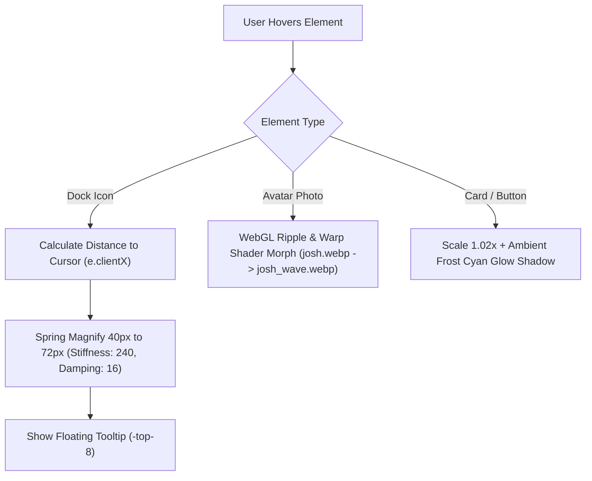

# Product Requirements Document (PRD) & Design System Specification
## Project: Sultan Syarif Al — Personal Portfolio
### Architecture & Design Standard: Apple "iOS 26 Liquid Glass & Pro Obsidian"
**Document Status:** Approved & Production-Ready  
**Version:** 1.0.0  
**Target Platform:** Next.js (App Router), Tailwind CSS, Motion (Framer Motion), WebGL (OGL)

---

## 1. Executive Summary & Product Vision

### 1.1 Vision
Portofolio personal milik **Sultan Syarif Al** (Mahasiswa Sistem Informasi Bisnis Polinema, Software Engineer, Programmer & GCS Drone Operator di AVRO) dirancang sebagai representasi digital berstandar industri tinggi dengan bahasa visual **Apple iOS 26 Liquid Glass** dipadukan dengan **Apple Pro Obsidian**.

### 1.2 Core Design Pillars
1. **The Void Canvas (Pro Obsidian `#07080b`)**:  
   Latar belakang gelap murni dengan sentuhan arang titanium yang tenang. Menghindari warna hitam mati (`#000000`) dan menghindari warna navy pekat jenuh (`#060d1e`) yang mengaburkan kontras.
2. **Liquid Glass & Translucency**:  
   Material kaca cair semi-transparan dengan keburaman tinggi (`backdrop-blur-2xl`), pantulan cahaya atas (*specular reflection*), dan garis tepi ganda berpresisi mikron.
3. **Frost Cyan Laser Accent (`#38bdf8`)**:  
   Warna aksen es biru cyan digunakan secara terukur (*laser precision*) sebagai penanda interaktivitas, bukan disiram ke seluruh latar belakang.
4. **Zero-Lag Tactile Physics (120 FPS)**:  
   Interaksi dermaga navigasi (*macOS floating dock*) yang responsif tanpa jeda input (`0ms delay`), mematuhi prinsip komputasi GPU murni.

---

## 2. Design Tokens & Color System

### 2.1 CSS Variables & Palette Tokens ([`app/globals.css`](file:///d:/my_project/rbp-portfolio/app/globals.css))

```css
/* Dark Mode (Default / Primary Experience) */
.dark {
  --background: #07080b;       /* Apple Pro Obsidian Canvas */
  --foreground: #f4f5f8;       /* Ice White Text (Soft on eyes) */
  --muted: #121318;            /* Card/Chip Container Surface */
  --muted-foreground: #9496a1; /* Titanium Gray Subtitles */
  --border: #1a1c24;           /* Subtle Obsidian Border */
  --ring: #38bdf8;             /* Frost Cyan Focus & Glow Ring */
  --primary: #38bdf8;          /* Frost Cyan Primary Accent */
  --frame: #07080b;
}

/* Light Mode (Serene Minimalist Ice) */
:root {
  --background: #ffffff;
  --foreground: #0a0a0a;
  --muted: #f5f5f5;
  --muted-foreground: #737373;
  --border: #e5e5e5;
  --ring: #0284c7;
  --primary: #0284c7;
  --frame: #ffffff;
}
```

### 2.2 Token Usage Matrix

| Token Name | Value | Purpose & Application |
| :--- | :--- | :--- |
| **Canvas Void** | `#07080b` | Latar belakang global, viewport theme-color, container full-bleed |
| **Frost Cyan** | `#38bdf8` (Sky-400) | Aksen utama: active dock ring, underline nama, rotating word, CTA hover |
| **Cyan Glow** | `rgba(56, 189, 248, 0.22 - 0.35)` | Box-shadow pendaran squircle foto, active dock pip, modal border |
| **Ice Cyan** | `#7dd3fc` / `#a5f3fc` | Highlight specular pada tepi atas bingkai kaca (*specular reflection*) |
| **Glass Surface** | `bg-white/10 dark:bg-[#0c0e14]/85` | Bilah dock, kartu layanan, dan background chip interaktif |
| **Ice White** | `#f4f5f8` | Tipografi heading dan judul utama |

---

## 3. Component Architecture & Specifications

### 3.1 Hero Section ([`components/hero/hero.tsx`](file:///d:/my_project/rbp-portfolio/components/hero/hero.tsx))

```
+--------------------------------------------------------------------------+
|  [Left Column: Typography & CTAs]     |  [Right Column: Liquid Squircle] |
|                                       |                                  |
|  Hai, Nama Saya / Hey, My Name is     |      +---------------------+     |
|  Sultan [Cyan Underline]              |      | [Frosted Cyan Rim]  |     |
|  Syarif Al .                          |      |   +---------------+ |     |
|  Saya seorang Software Engineer &     |      |   | Full-Color    | |     |
|  [Rotating Word: Student, Dev, GCS..] |      |   | Anime Avatar  | |     |
|  [Bilingual Bio Description]          |      |   | Morph on      | |     |
|                                       |      |   | Hover         | |     |
|  [Socials] (Github, In, X, Mail)      |      |   +---------------+ |     |
|  [Contact CTA]  [View My Project ->]  |      +---------------------+     |
+--------------------------------------------------------------------------+
```

#### Specification Rules:
1. **Fit-to-Screen Constraints**:  
   Halaman Home terkunci pada viewport desktop (`fixed inset-0 overflow-hidden` pada [`app/page.tsx`](file:///d:/my_project/rbp-portfolio/app/page.tsx)) tanpa vertical scrolling yang tidak disengaja.
2. **Rotating Role Flipper**:  
   Animasi pergantian kata vertikal (`Student`, `Gamer`, `GCS Operator`, `Full-Stack Dev`, `AI/ML Explorer`, `Drone Enthusiast`) dengan teks `text-sky-400 dark:text-sky-300 font-bold underline underline-offset-6 decoration-sky-400/60`.
3. **Nama Sultan Underline**:  
   Garis gradasi halus `bg-gradient-to-r from-sky-400 via-cyan-300 to-sky-500 shadow-[0_2px_14px_rgba(56,189,248,0.5)]`.
4. **Portrait Squircle (Liquid Glass Frame)**:
   - Outer Frame: `rounded-[2.35rem] sm:rounded-[2.65rem] border-2 border-sky-400/50 dark:border-sky-400/40`.
   - Translucent Glass Fill: `bg-gradient-to-b from-sky-400/15 via-white/10 to-sky-500/10 dark:from-sky-400/10 dark:via-white/[0.04] dark:to-sky-400/5 backdrop-blur-2xl`.
   - Specular Top Light: `bg-gradient-to-b from-sky-300/30 via-white/10 to-transparent`.
   - Ambient Glow: `shadow-[0_0_35px_rgba(56,189,248,0.25)]` berpadu dengan blur halo di belakang frame.
   - Foto: **Full color wajib** ([`public/josh.webp`](file:///d:/my_project/rbp-portfolio/public/josh.webp)). Properti `filter: grayscale(...)` dilarang keras diterapkan.

---

### 3.2 Floating macOS Magnification Dock ([`components/layout/nav.tsx`](file:///d:/my_project/rbp-portfolio/components/layout/nav.tsx))

```
           [Tooltip: "Skills"]
                   |
                  (o) 72px (Hovered Peak)
              (o)     (o) 54px (Neighbor Waves)
          (o)             (o) 40px (Resting)
       +---------------------------------------------+
       |  [Home] [User] [Lightbulb] [Edu] [Proj] ... |
       +---------------------------------------------+
               ^ Flat Bottom Baseline (items-end)
```

#### Specification Rules:
1. **Bottom Baseline Alignment**:  
   Container menggunakan `flex h-16 items-end gap-2.5 sm:gap-3 rounded-2xl pb-2.5 px-3.5`. Seluruh elemen bertumpu pada garis bawah, sehingga pembesaran ikon bergerak secara natural **ke arah atas**.
2. **Physics & Proximity Spring**:
   - Tracking mouse via `useMotionValue(e.clientX)`.
   - Perhitungan jarak `useTransform(mouseX, [-140, 0, 140], [40, 72, 40])`.
   - Spring configuration: `{ mass: 0.1, stiffness: 240, damping: 16 }`.
   - Pembesaran ikon grafis di dalam lingkaran: `useTransform(distance, [-140, 0, 140], [18, 32, 18])`.
3. **Performance Requirement (Strict Zero-Lag Rule)**:  
   > [!CRITICAL]
   > Dilarang menambahkan kelas Tailwind `transition-all` pada elemen yang ukurannya dimanipulasi oleh Framer Motion `style={{ width }}`. Hanya gunakan `transition-colors duration-150` untuk perubahan warna border/latar.
4. **Active State Representation**:  
   - Cincin aktif: Lingkaran kaca cair Frost Cyan penuh `border-2 border-sky-400 bg-sky-400/15 text-sky-400 shadow-[0_0_16px_rgba(56,189,248,0.35)] ring-1 ring-sky-400/30`.
   - **Tanpa Titik Bawah**: Tidak boleh menambahkan pip/dot indikator di tepi bawah menu aktif.
5. **Tooltip Placement**:  
   Pill melayang tepat di atas titik puncak lingkaran (`absolute -top-8 left-1/2 -translate-x-1/2 rounded-md bg-background/95 px-2 py-0.5 text-[11px]`).

---

### 3.3 Page Backdrop & Fluid Silk WebGL Waves ([`components/layout/page-backdrop.tsx`](file:///d:/my_project/rbp-portfolio/components/layout/page-backdrop.tsx))

#### Specification Rules:
1. **Latar Belakang Obsidian Smoked Glass**:  
   Tidak menggunakan bola-bola aurora warna solid yang jenuh. Menggunakan radial vignette halus di sudut atas:
   `bg-[radial-gradient(ellipse_80%_60%_at_50%_-10%,rgba(56,189,248,0.08),transparent_70%)]`.
2. **Parameter Shader WebGL (`ShaderFlow`)**:
   - `colorLowA`: `[0.03, 0.04, 0.06]` (Deep Smoked Obsidian).
   - `colorHighA`: `[0.22, 0.74, 0.97]` (Luminous Frost Cyan `#38bdf8`).
   - `brightness`: `2.0`.
   - `flowSpeed`: `[0, 0.07]`.
   - `scale`: `5.0`.
   - `iterations`: `11`.
   - Opacity container: `opacity-50 dark:opacity-65`.

---

### 3.4 Skills & Experience Page Structure ([`app/skills/page.tsx`](file:///d:/my_project/rbp-portfolio/app/skills/page.tsx))

```
+--------------------------------------------------------------+
| 1. Skills Hero                                               |
|    - Direct Title: "My Technical Experience / Skills"        |
|    - (Badge "TECHNICAL EXPERTISE" REMOVED)                   |
|    - Quick Stats (20+ Techs, 4 Domains, AVRO Operator, 6+ C) |
+--------------------------------------------------------------+
| 2. Categorized Tech Stack Grid & Filter Tabs                 |
|    - Languages, Frameworks, Tools, AI/ML, Robotics           |
|    - Search bar with Frost Cyan focus ring                   |
+--------------------------------------------------------------+
| 3. "What I Do" Domains                                       |
|    - Backend Engineering                                     |
|    - Mobile App Development (Flutter/Android)                |
|    - UAV GCS Telemetry & Robotics (AVRO)                     |
|    - Machine Learning & Computer Vision                      |
+--------------------------------------------------------------+
| 4. Interactive Drag & Drop Matter.js Stack Playground        |
|    - Physical gravity-based chips with drag capability       |
+--------------------------------------------------------------+
| 5. Certificates & Achievements Showcase                      |
|    - Filter: All, Bootcamp, Seminar, Competition, Cert       |
|    - (Badge "CREDENTIALS & HONORS" REMOVED)                  |
|    - Modal Detail on Card Click                              |
+--------------------------------------------------------------+
| (Note: "Let's Connect" CTA REMOVED from Skills Page)         |
+--------------------------------------------------------------+
```

---

## 4. Typography Hierarchy

| Role | Font Family | Size (Desktop / Mobile) | Weight | Tracking |
| :--- | :--- | :--- | :--- | :--- |
| **Hero Display Name** | Geist Sans (`font-sans`) | `3.75rem` / `2.4rem` | Bold (`700`) | Tight (`-0.03em`) |
| **Section Headings** | Fraunces (`font-serif`) | `3.25rem` / `2.25rem` | Medium (`500`) | Tight (`-0.02em`) |
| **Card & Sub-headers**| Fraunces / Geist Sans | `1.25rem` / `1.1rem` | Medium / Semi | Snug |
| **Body & Bios** | Geist Sans (`font-sans`) | `1rem` / `0.9rem` | Regular (`400`) | Normal |
| **Badges & Monospace**| Geist Mono (`font-mono`) | `0.75rem` / `0.7rem` | Medium (`500`) | Wide (`0.05em`) |

---

## 5. Interaction & Motion Guidelines



### 5.1 Motion Principles
- **No Abrupt Cuts**: Seluruh status transisi menggunakan pegas teredam (*damped springs*) atau kurva ease Apple `[0.22, 1, 0.36, 1]`.
- **Hardware Acceleration**: Seluruh animasi dinamis wajib beroperasi pada GPU properties: `transform` (scale, translate) dan `opacity`.
- **Accessibility**: Mendukung penuh `prefers-reduced-motion` untuk menonaktifkan simulasi pegas berat dan WebGL morphing jika diminta oleh sistem operasi pengguna.

---

## 6. Implementation Quality Checklist (Do's & Don'ts)

### ✅ DO's:
- **Pertahankan latar `#07080b`** pada mode gelap agar kontras terhadap aksen Frost Cyan `#38bdf8` tetap tajam (*crisp*).
- **Gunakan perataan `items-end`** pada dock navigation untuk memastikan animasi magnifikasi tumbuh ke arah atas.
- **Biarkan foto potret tetap dalam warna aslinya** (hindari grayscale).
- **Pertahankan dwibahasa (ID / EN)** pada seluruh konten dengan `useLanguage()` context.
- **Lakukan verifikasi berkala** dengan `npx tsc --noEmit` untuk menjaga integritas tipe TypeScript.

### ❌ DON'Ts:
- **JANGAN menambahkan kembali titik (*dot indicator*)** pada bagian bawah menu aktif di dock navigation.
- **JANGAN menambahkan kelas `transition-all`** pada elemen yang dimensinya dikontrol oleh motion spring.
- **JANGAN mengubah latar belakang menjadi warna biru pekat/navy jenuh**, karena akan menenggelamkan kontras border biru kaca.
- **JANGAN memasang kembali badge pill yang telah dihapus** (*"TECHNICAL EXPERTISE"*, *"CREDENTIALS & HONORS"*).
- **JANGAN menambahkan komponen ContactCard** di bagian bawah halaman Skills.

---

## 7. Version History & Sign-Off

| Version | Date | Author / Agent | Changes Summary |
| :--- | :--- | :--- | :--- |
| **0.9.0** | 2026-10-29 | Pair Programming | Inisialisasi tema awal, hero layout, bilingual context |
| **0.9.5** | 2026-10-30 | Antigravity AI | Pembuatan halaman skills, stack playground Matter.js, sertifikat |
| **1.0.0** | 2026-10-30 | Antigravity AI | Penerapan standar Apple Pro Obsidian & Frost Cyan, restorasi dock macOS 120 FPS, optimasi foto full-color, dan penguncian desain sistem PRD. |
